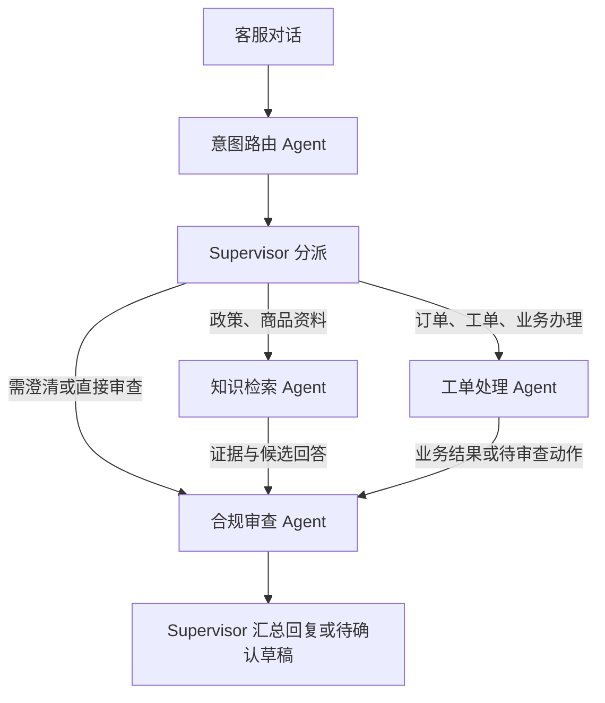
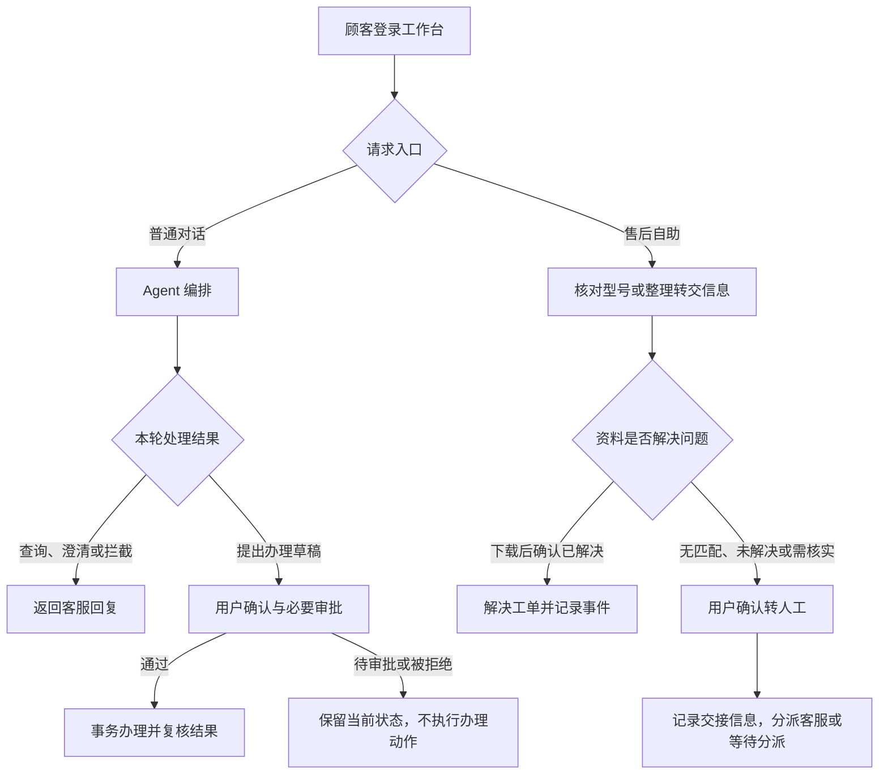

# 售后协作台 · Aftercare Agent Desk

面向电商售后的多 Agent 客服工作台。顾客可以查资料、查订单和工单，也可以提交售后申请。系统能处理有明确规则的自助请求，遇到需要人工判断的情况，会把问题和已经查到的信息一并交给客服。

## 项目背景

电商售后经常遇到两类问题。说明书缺失、配送规则和退款进度等常见咨询，客服往往在重复查找资料。商品破损、赔偿和退款申请则需要核对订单、确认用户意愿，有时还要交由独立人员审批。如果这些信息只留在聊天里，客服接手时还要重新问一遍。

这个项目把知识库查询、受权限约束的订单和工单操作放进同一个工作台。顾客可以看到处理进度，客服可以接着已核对的信息办理，管理员可以维护知识资料及其发布版本。

## 能用来做什么

| 应用场景 | 用户怎么用 | 系统如何处理 |
| --- | --- | --- |
| 找商品说明书 | 「包装里缺少说明书，帮我找型号 DEMO-X1 的说明书。」 | 按完整型号匹配已发布的公开文件。用户下载并确认解决后，系统更新符合条件的工单，或新建一条已解决的记录。 |
| 查询售后政策 | 「这个商品收到后，哪些情况可以申请退货？」 | 在已启用的知识库中检索适用资料，给出带来源的答案。依据不足时提示补充信息或无法确认。 |
| 查订单或工单 | 「请查询我这张工单的处理进度。」 | 根据账号归属查询数据库中的实际状态。缺少必要编号时提示补充。 |
| 提交退款申请 | 「请帮我为这笔订单提交退款申请。」 | 核对订单并生成申请草稿。用户确认，且必要审批通过后，系统记录办理结果。 |
| 商品破损或需要赔偿 | 「收到的包裹破损了，请转人工客服。」 | 用户确认转交后，工单附上问题摘要、已核实的订单信息和客服下一步要核实的事项。 |

普通用户使用「客服对话」「我的工单」和「售后自助处理」，客服在工作台接手工单，管理员负责知识发布及有权限的后台操作。项目使用演示业务规则，退款流程处理申请与审批，实际资金划拨需要另行接入支付系统。

## 四个 Agent 的编排图

客服对话进入 LangGraph 后，由意图路由 Agent 分类，再由 Supervisor 选择分支。复合诉求可按依赖顺序执行多个任务，例如先查政策，再核对订单并准备工单草稿。



聊天页可查看本轮实际调用的 Agent。办理动作经确认和必要审批后由服务端执行，办理结果由同一个合规角色复核。完整节点和复合任务路径见[详细编排图](docs/agent-orchestration.md)。

## 客服系统的处理流程

顾客可以从聊天、侧栏的「售后自助处理」或已有工单进入。普通对话交由 Agent 编排。明确的说明书请求或转人工请求可进入独立的自助入口。



React 通过 FastAPI 提交请求。常规聊天的进度由 SSE 返回，用户在会话中可查看执行节点。说明书按完整型号匹配当前公开版本，确认时再次核对资料和工单状态。[售后自助处理说明](docs/self-service.md)

### 查询、办理和转人工分别保存什么

| 用户操作 | 保存结果 |
| --- | --- |
| 询问售后政策或查询订单、工单 | 保存对话和运行事件，订单及工单状态保持原样。 |
| 查找或下载说明书 | 保存自助会话，等用户明确确认后再写入工单。 |
| 确认说明书已解决 | 保存工单状态、处理事件和回执。重复提交返回同一回执。 |
| 确认提交退款申请 | 保存申请确认、必要审批及办理记录，工单按流程更新。 |
| 确认转人工 | 保存交接记录及处理人，原工单受审批保护时保留其业务状态。 |

款项到账属于外部支付系统的职责。文档撤下、工单被他人更新或权限校验失败时，系统停止相应的写入，并提示刷新或改走人工处理。

## 技术栈

- **前后端**使用 React、TypeScript、Vite 和 Python、FastAPI，通过 SSE 展示对话运行进度。
- **检索**支持 PDF、HTML 等资料解析，使用 BGE-M3、PostgreSQL / pgvector 和可选的 BM25 / RRF 混合检索及 BGE 重排序。
- **存储与任务**使用 PostgreSQL 保存业务记录、会话和执行事件，Redis 支持缓存，Celery 执行后台任务。

## 本地启动

新环境准备 Python 3.12、Node.js 24 和 Docker Compose。在项目根目录创建 `.venv` 和 `.env`。已有 `.env` 时保留当前文件。

```powershell
python -m venv .venv
.\.venv\Scripts\python.exe -m pip install -r requirements.lock.txt
.\.venv\Scripts\python.exe -m pip install -e . --no-deps
if (-not (Test-Path -LiteralPath '.env')) { Copy-Item .env.example .env }
```

需要体验 AI 对话时，在根目录 `.env` 填写 `OPENAI_API_KEY`、`OPENAI_BASE_URL` 和 `MODEL_NAME`。然后启动数据库、构建前端并创建本地演示账号。

```powershell
.\.venv\Scripts\python.exe -m smart_cs.foundation configure
docker compose -p smart-cs-foundation up -d --wait postgres redis
.\.venv\Scripts\python.exe -m smart_cs.delivery init
Push-Location frontend
npm ci
npm run build
Pop-Location
.\.venv\Scripts\python.exe scripts/manage_accounts.py bootstrap
.\.venv\Scripts\python.exe -m smart_cs.delivery serve
```

打开[客服工作台](http://127.0.0.1:8000/)登录，首次账号凭据按初始化脚本提示在本机查看。[FastAPI 接口文档](http://127.0.0.1:8000/docs)

### 演示说明书自助

在另一个 PowerShell 窗口的项目根目录录入虚构型号的说明书。此脚本面向本地演示 PostgreSQL。

```powershell
.\.venv\Scripts\python.exe scripts/seed_self_service_demo.py
```

1. 用普通用户打开「售后自助处理」，查找 `DEMO-X1`，下载说明书并点击「确认已解决」。
2. 打开「我的工单」，核对状态为「已解决」及对应的操作记录。
3. 换用未录入的 `DEMO-X2`，确认页面只提供转人工等后续选项。提交后，使用已获分派的客服账号在「客服工作台」查看交接内容。

启用政策问答前，需要导入有使用权限的知识资料、配置检索服务并建立索引。订单和工单查询则需要准备归属当前用户的业务数据。

## 代码导航

| 路径 | 内容 |
| --- | --- |
| `frontend/src/` | 客服对话、售后自助及各角色的工作台 |
| `src/smart_cs/agents/` 与 `src/smart_cs/api/` | Agent 编排与 FastAPI 接口 |
| `src/smart_cs/services/` 与 `src/smart_cs/repositories/` | 工单、审批、自助处理及事务写入 |
| `src/smart_cs/ingestion/` 与 `src/smart_cs/retrieval/` | 文件入库、检索与引用 |
| `migrations/` 与 `deploy/` | 数据库迁移和部署配置 |
| `tests/` 与 `frontend/e2e/` | 后端自动化测试和浏览器回归测试 |

## 验证与部署

```powershell
.\.venv\Scripts\python.exe scripts/check_source_snapshot.py
```

前端在 `frontend` 下运行 `npm run build` 和 `npm run test:e2e`，浏览器测试需要先安装 Playwright 浏览器。上述检查覆盖代码契约和界面行为。真实模型与知识库的回答质量需要用部署者自己的资料验证。[容器部署说明](docs/deployment.md)

公开仓库提供源码和 `.env.example` 配置模板。真实密钥、账号凭据、数据集、数据库、知识原件及模型权重由部署者在自己的环境中准备。

## 来源与许可

本项目在开源项目的四 Agent 思路上扩展了 Python 实现，保留上游 MIT 许可证及版权声明。[上游项目](https://github.com/bcefghj/smart-cs-multi-agent) · [MIT 许可证](LICENSE)
