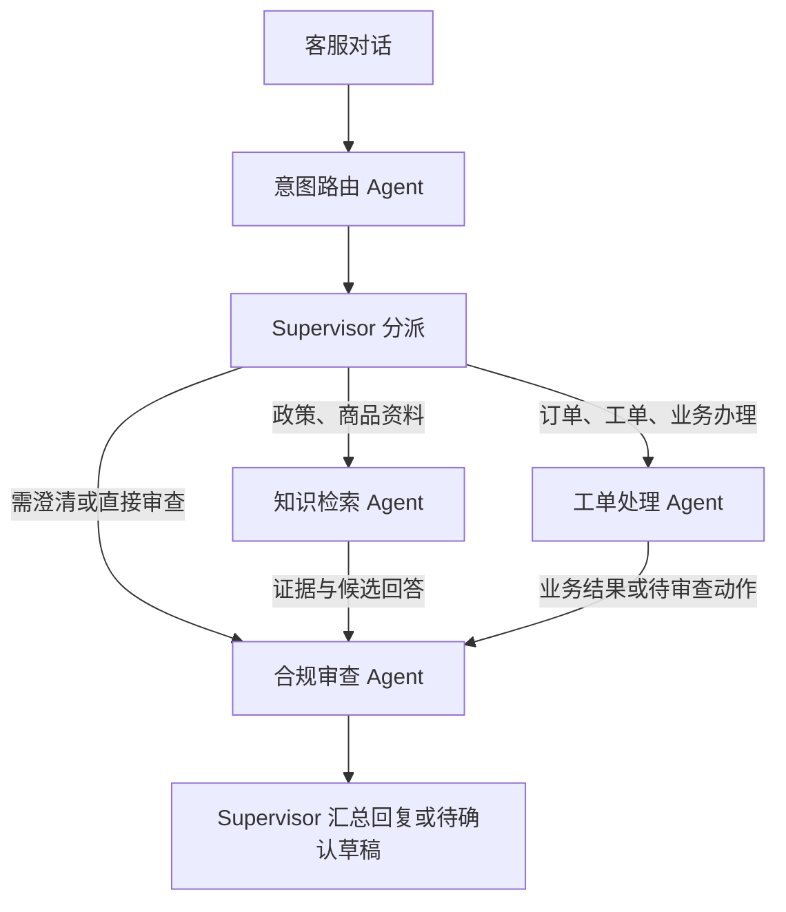
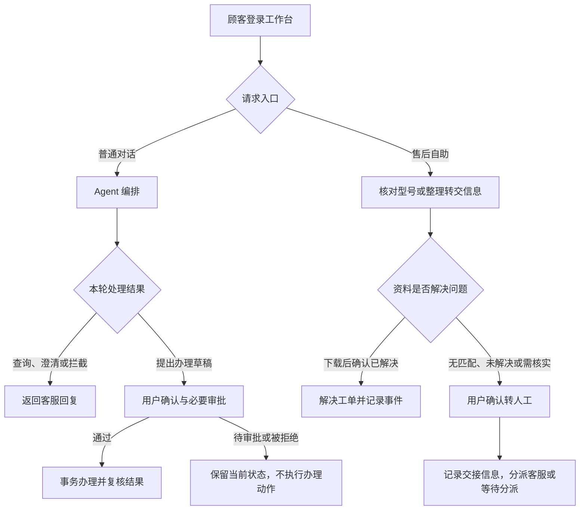

# 售后协作台 · Aftercare Agent Desk

售后协作台是一个面向电商的多 Agent 客服系统。顾客可以在工作台查资料、跟进订单和工单，也能提交售后申请。

## 项目背景

包装里少了一本说明书，顾客通常只需要拿到对应型号的文件。配送规则和退款进度也经常有人问。遇到商品破损、赔偿或退款申请，客服还需要核对订单、确认顾客的诉求，并视情况交给独立人员审批。聊天记录和工单分开时，接手的客服往往要把这些问题再问一遍。

顾客可以自己查找说明书，下载后确认问题是否解决。需要人工判断时，顾客确认转交，接手的客服就能从工单看到诉求、已核实的订单信息和接下来要查的事项。

## 能用来做什么

| 应用场景 | 用户怎么用 | 系统如何处理 |
| --- | --- | --- |
| 找商品说明书 | 「包装里缺少说明书，帮我找型号 DEMO-X1 的说明书。」 | 按完整型号找已发布的公开文件。顾客下载并确认解决后，系统会更新符合条件的原工单。没有关联工单时，系统新建一张已解决的工单。 |
| 查询售后政策 | 「这个商品收到后，哪些情况可以申请退货？」 | 从已启用的知识库查找相关资料，回答时附上来源。依据不足时，系统会请顾客补充信息，或回复暂时无法确认。 |
| 查订单或工单 | 「请查询我这张工单的处理进度。」 | 先核对账号归属，再查数据库里的当前状态。缺少必要的编号时，请顾客补充。 |
| 提交退款申请 | 「请帮我为这笔订单提交退款申请。」 | 核对订单并生成申请草稿。顾客确认且必要审批通过后，系统记录办理结果。 |
| 商品破损或需要赔偿 | 「收到的包裹破损了，请转人工客服。」 | 顾客确认转交后，工单会附上问题摘要、已核实的订单信息和待核实事项。 |

顾客在「客服对话」提问，在「我的工单」查看进度，也可以直接打开「售后自助处理」。客服从工作台接手工单，管理员按权限发布资料、管理版本。

## 四个 Agent 的编排图

意图路由 Agent 先判断顾客要处理什么，Supervisor 再用 LangGraph 调度相应分支。一条消息有多个诉求时，Supervisor 可以按依赖顺序安排任务。比如先查退货政策，再核对订单并准备工单草稿。



聊天页会列出本轮实际执行的节点。需要办理业务时，服务端在顾客确认和必要审批完成后执行动作，再由合规审查 Agent 复核办理结果。完整的节点和任务分支见[详细编排图](docs/agent-orchestration.md)。

## 客服系统的处理流程

普通聊天交给 Agent 处理。顾客在聊天里明确提出找说明书或转人工时，可以进入自助流程，也能从侧栏或已有工单打开同一入口。



React 前端把请求提交给 FastAPI，后端通过 SSE 把聊天进度推送到页面。说明书查询按完整型号匹配当前公开版本，顾客确认解决时，服务端会再查一次资料有效性和工单状态。[售后自助处理说明](docs/self-service.md)

### 查询、办理和转人工分别保存什么

| 用户操作 | 保存结果 |
| --- | --- |
| 询问售后政策或查询订单、工单 | 保存对话和运行事件，订单及工单状态保持原样。 |
| 查找或下载说明书 | 系统先记录本次自助请求，收到明确确认后再写入工单。 |
| 确认说明书已解决 | 系统写入工单状态和处理事件。重复确认会拿到原来的回执。 |
| 确认提交退款申请 | 系统保留确认和审批记录。办理完成后，更新工单并保存结果。 |
| 确认转人工 | 工单记录交接内容。分派成功时会记录处理人。受审批保护的原工单保留当前业务状态。 |

项目使用演示业务规则，退款流程覆盖申请和审批。实际资金划拨需接入支付系统。资料下架、工单版本已变更或权限校验失败时，服务端会拦截相应写入，页面根据情况提示刷新或转人工。

## 技术栈

前端用 React、TypeScript 和 Vite，后端用 Python、FastAPI 和 LangGraph。

知识库可以解析 PDF、HTML 等文件。向量检索使用 BGE-M3 和 PostgreSQL 的 pgvector 扩展，也可以启用 BM25 / RRF 混合检索和 BGE 重排序。PostgreSQL 同时保存业务记录、会话和运行事件，Redis 用于缓存，Celery 负责后台任务。

## 本地启动

先安装 Python 3.12、Node.js 24 和 Docker Compose。在项目根目录创建 `.venv`，并准备 `.env`。命令会保留已有的 `.env`。

```powershell
python -m venv .venv
.\.venv\Scripts\python.exe -m pip install -r requirements.lock.txt
.\.venv\Scripts\python.exe -m pip install -e . --no-deps
if (-not (Test-Path -LiteralPath '.env')) { Copy-Item .env.example .env }
```

要使用 AI 对话，先在项目根目录的 `.env` 中填写 `OPENAI_API_KEY`、`OPENAI_BASE_URL` 和 `MODEL_NAME`。接着启动数据库、构建前端、创建演示账号并运行服务。

```powershell
.\.venv\Scripts\python.exe -m smart_cs.foundation configure
docker compose -p smart-cs-foundation up -d --wait postgres redis
.\.venv\Scripts\python.exe -m smart_cs.delivery init
Push-Location frontend
npm ci
npm run build
Pop-Location
.\.venv\Scripts\python.exe scripts/manage_accounts.py bootstrap
.\.venv\Scripts\python.exe -m smart_cs.delivery serve
```

按初始化脚本的提示在本机查看账号凭据，然后打开[客服工作台](http://127.0.0.1:8000/)登录。调试接口时可查看[FastAPI 接口文档](http://127.0.0.1:8000/docs)。

### 演示说明书自助

服务启动后，再打开一个 PowerShell 窗口，进入项目根目录。以下命令会把一份虚构型号的说明书录入本地演示用的 PostgreSQL。

```powershell
.\.venv\Scripts\python.exe scripts/seed_self_service_demo.py
```

1. 用普通用户登录，打开「售后自助处理」。查找 `DEMO-X1`，下载说明书，勾选确认后点击「确认已解决」。
2. 到「我的工单」查看「已解决」状态和对应的处理记录。
3. 查找未录入的 `DEMO-X2`。页面提示找不到匹配资料，此时可以提交转人工。用接到工单的客服账号登录，在「客服工作台」查看交接内容。

试用政策问答时，先配置检索服务，导入有使用权限的资料并建立索引。要查订单和工单，需要准备归属于登录账号的业务数据。

## 代码导航

| 路径 | 内容 |
| --- | --- |
| `frontend/src/` | 客服对话、售后自助及各角色的工作台 |
| `src/smart_cs/agents/` 与 `src/smart_cs/api/` | Agent 编排与 FastAPI 接口 |
| `src/smart_cs/services/` 与 `src/smart_cs/repositories/` | 工单、审批、自助处理及事务写入 |
| `src/smart_cs/ingestion/` 与 `src/smart_cs/retrieval/` | 文件入库、检索与引用 |
| `migrations/` 与 `deploy/` | 数据库迁移和部署配置 |
| `tests/` 与 `frontend/e2e/` | 后端自动化测试和浏览器回归测试 |

## 验证与部署

```powershell
.\.venv\Scripts\python.exe scripts/check_source_snapshot.py
```

进入 `frontend` 运行 `npm run build` 构建前端。安装 Playwright 浏览器后，运行 `npm run test:e2e` 检查页面流程。这些测试覆盖接口约定和页面操作。部署前可用自己的知识资料试问几轮，核对回答和引用。[容器部署说明](docs/deployment.md)

仓库提供源码和 `.env.example` 配置模板。密钥、账号凭据、数据集、数据库、知识文件和模型权重需要在部署环境里准备。

## 来源与许可

这个项目以上游的四 Agent 设计为基础，用 Python 实现了售后知识库、工单和自助处理。代码继续使用 MIT 许可证，并保留上游版权声明。[上游项目](https://github.com/bcefghj/smart-cs-multi-agent) · [MIT 许可证](LICENSE)
